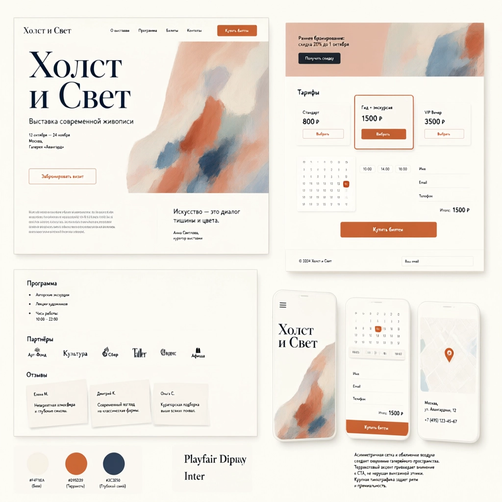
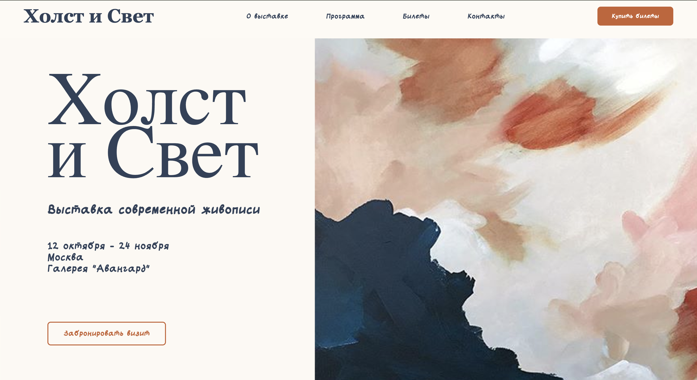
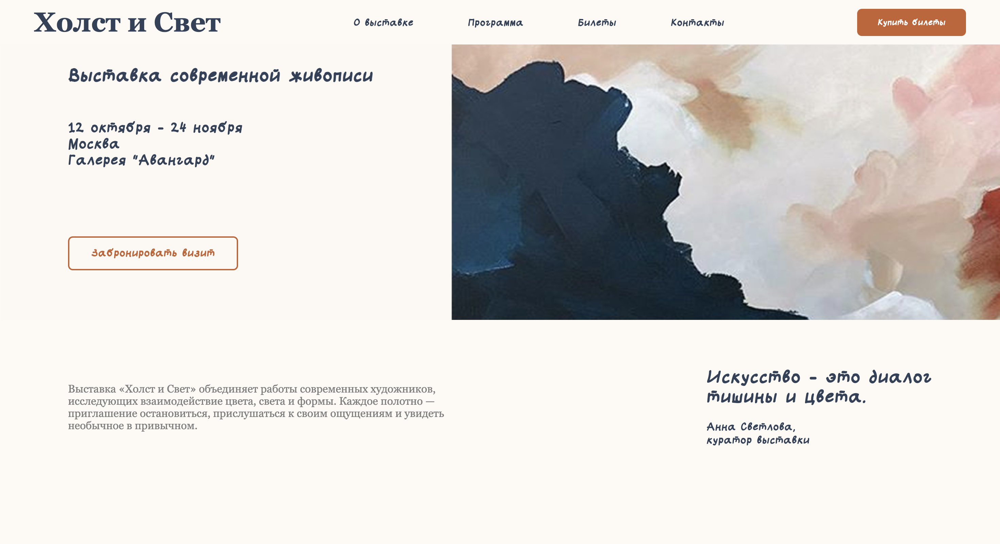
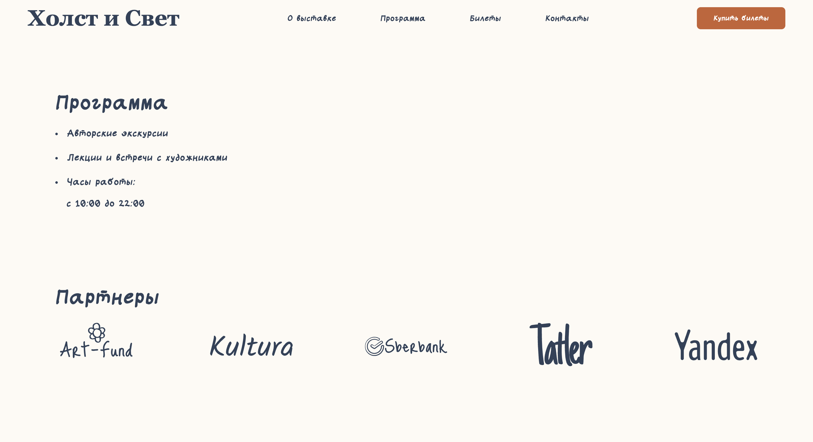
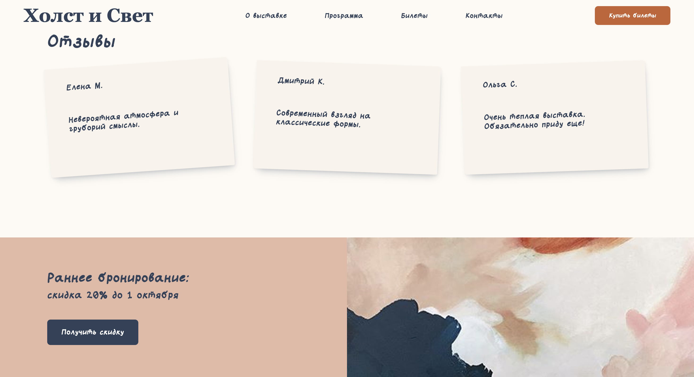
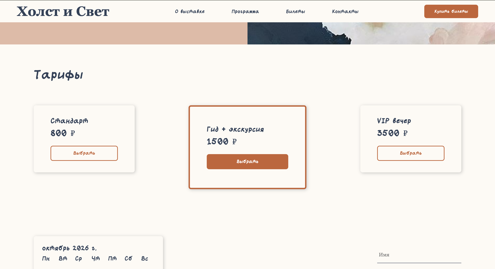
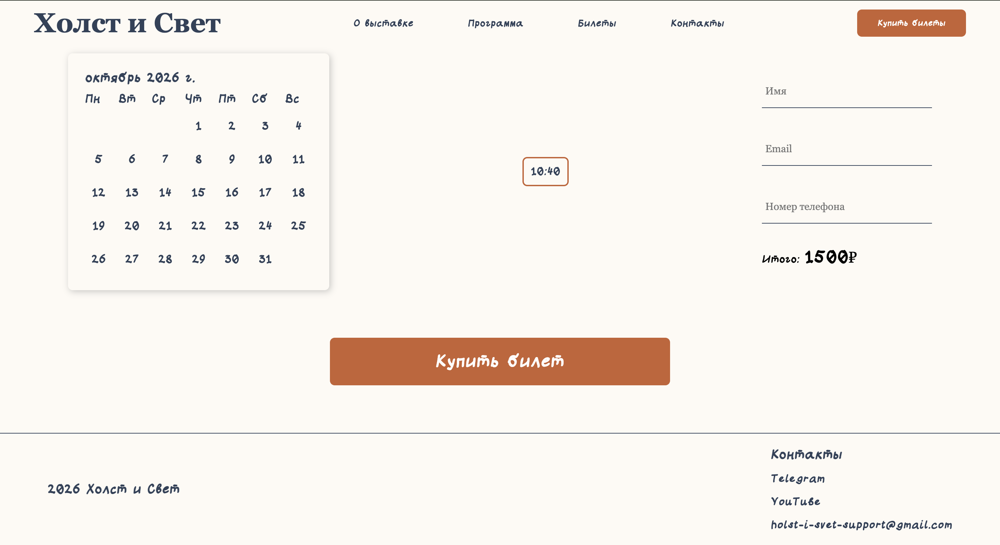
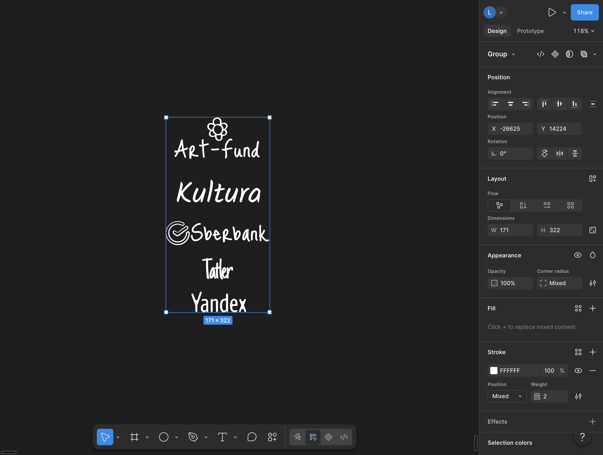
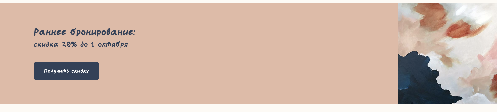

# Первый проект
Данный проект является практической частью в первом этапе обучения creative frontend development <br>
В этом проекте показываются мои знания и умения, которые были получены в процессе обучения <br>


**Важная информация** <br>
!Дизайн страницы был создан не мной, а ИИ!


---

## Содержание
- [Первый проект](#первый-проект)
  - [Содержание](#содержание)
  - [Скриншоты реализованной страницы](#скриншоты-реализованной-страницы)
  - [С какими трудностями столкнулась](#с-какими-трудностями-столкнулась)
  - [Что и как удалось решить](#что-и-как-удалось-решить)
  - [Какие навыки были получены в процессе](#какие-навыки-были-получены-в-процессе)



**Задача:** <br>
Реализовать сайт, максимально приближенный по внешнему виду к макету, созданному с помощью ИИ.

## Скриншоты реализованной страницы







## С какими трудностями столкнулась
1. Изменение цвета svg логотипов партнеров в css
2. Не ровное разделение контейнера sale (нужно было сделать 50/50)
   
## Что и как удалось решить 
1. SVG логотипы партнеров были созданы мной в Figma в белом цвете <br> 

Было принято решение делать в базавом белом цвете и красить в css файле для большей мобильности.
Сложность возникла именно с процессом покраски. <br>
**Решение** <br>
Для решения проблемы я использовала маски в css <br>
``` css
-webkit-mask: var(--logo) center / contain no-repeat; 
mask: var(--logo) center / contain no-repeat;
```
**--logo** - это переменная, которая содержит в себе путь к файлу, чтобы не создавать стиль для всех 5-и логотипов <br>
Путь просинам в html документе с помощью **span** и **style** <br>
*Первый логотип:*
```html
<span  
    class="partner-icon" 
    style="--logo: url('icons/art-fond.svg')"
    role="img" 
    aria-label="Арт-фонд">
</span>
```

Сам же цвет задается в css файле с помощью background-color
```css
background-color: #314159;
```

2. Для секции со скидкой необохдимо было, чтобы часть с тектом и часть с картинкой были равными <br>
Изначально мной были использованы только *display: flex;* и *justiry-content: space-between;* <br>
*space-between* не делит пространство пополам, а лишь распределяет объекты в контейнере с равным расстоянием, при этом размер самих блоков может быть увеличен или уменьшен. <br>
*ДО*

**Решение** <br>
Для решения данной проблемы я сделала для левой и правой частей *flex* и *min-width*, убрав justiry-content: space-between; у sale
```css
.sale .left-side,
.sale .right-side {
    flex: 0 0 50%; 
    min-width: 0;
}
```
flex указывает, что увеличение и уменьшение блоков происходить не будет, а начальный размер каждого блока - 50% от ширины контейнера.

## Какие навыки были получены в процессе
* 